<div align="center">

# DOOM-NUKEM

**Un FPS rétro en raycasting, écrit en C from scratch: secteurs, pentes, ascenseurs, boss, multijoueur en réseau et éditeur de niveaux intégré.**\
**Réalisé par Lucas, Anas et Elena**

**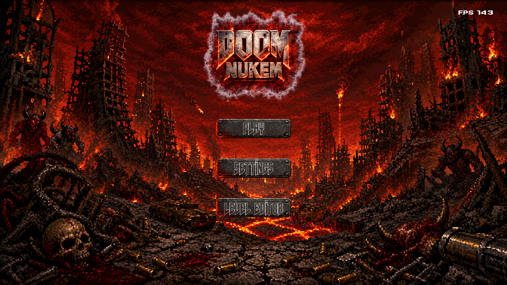**

</div>

---

## 📖 Sommaire

- [L'histoire](#-lhistoire)
- [Installation](#-installation)
- [Contrôles](#-contrôles)
- [Moteur de rendu](#-moteur-de-rendu)
- [Gameplay](#-gameplay)
- [Armes, objets et inventaire](#-armes-objets-et-inventaire)
- [Ennemis, boss et PNJ](#-ennemis-boss-et-pnj)
- [HUD](#-hud)
- [Menus et interface](#-menus-et-interface)
- [Musique custom](#-musique-custom)
- [Multijoueur](#-multijoueur)
- [Éditeur de niveaux](#-éditeur-de-niveaux)
- [Sous le capot](#-sous-le-capot)
- [Équipe](#-équipe)

---

## 🧬 L'histoire

> *In the depths of Black Mesa Research Facility, an experiment went catastrophically wrong.*

Un pathogène d'origine inconnue s'est échappé du confinement et réécrit la biologie humaine en quelques heures. Ce n'était pas une invasion, c'était une transformation. Tu es le dernier agent envoyé sur place pour découvrir la vérité… et le dernier espoir de l'humanité.

En descendant dans les profondeurs du complexe, tu découvres qu'une **lumière bleue** est apparue quelques instants avant l'épidémie. Pas de panne, pas d'erreur humaine : le pathogène a été *livré*. Quelque chose est passé de l'autre côté, et ça t'attend tout en bas.

Le jeu est découpé en **3 niveaux**, chacun introduit par une **cinématique animée** avec sous-titres :

| Niveau | Ambiance | Objectif |
|:---:|---|---|
| **1** | Le laboratoire de recherche : les scientifiques fuient, la fumée envahit les couloirs | Trouver la clé en zone de confinement pour ouvrir les labos |
| **2** | Le sous-sol : une lueur bleue pulse dans l'obscurité | Atteindre la salle de contrôle qui ouvre la porte de la caverne |
| **3** | L'antre de l'entité : éclairs, tonnerre, deux yeux dans le noir | Piller l'armurerie et abattre le boss final |

**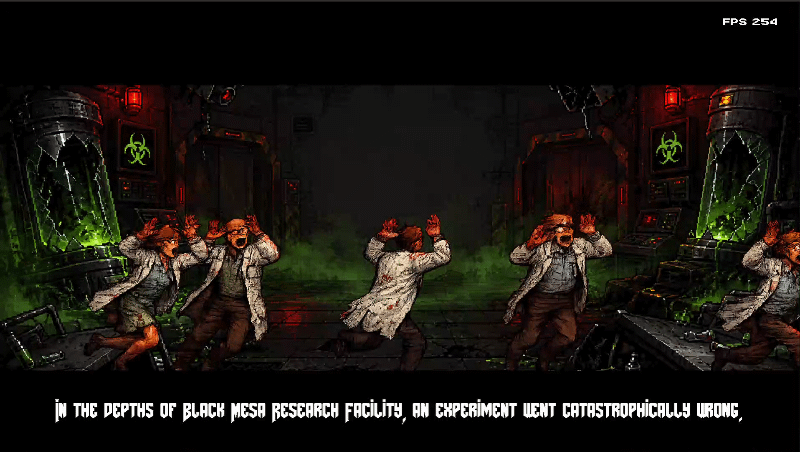**

**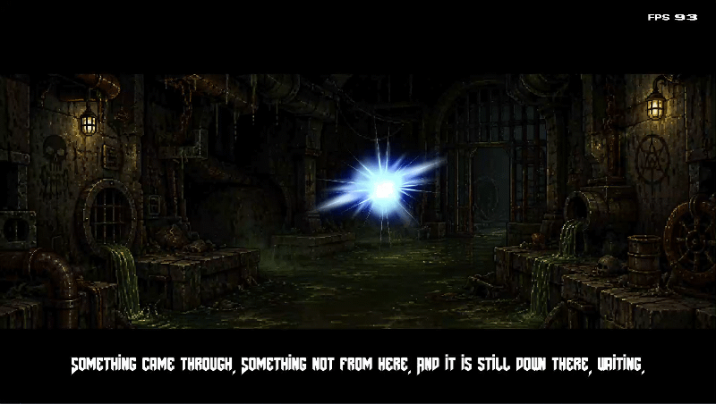**

**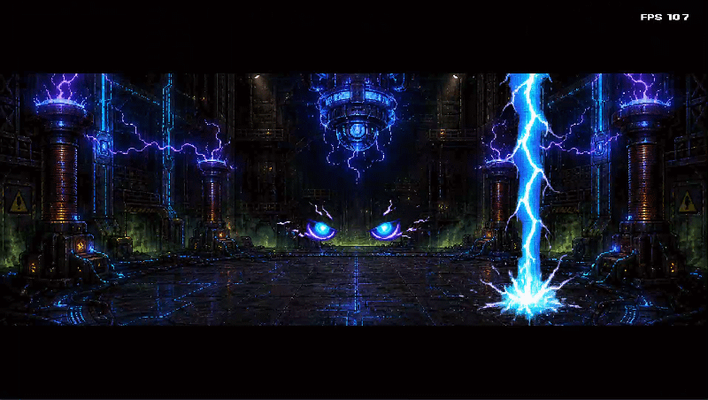**

Chaque niveau a un **début** (spawn + cinématique) et une **fin** : un ascenseur de sortie qui t'emmène au niveau suivant. Au niveau 3, la victoire se déclenche quand tous les boss sont morts → écran **THE END / YOU BEAT THE GAME!**

---

## 🔧 Installation

### Prérequis

- Linux, `cc`, `make`, `curl`
- Une carte graphique avec OpenGL (utilisée seulement par SDL pour la fenêtre, **aucune accélération 3D** dans le rendu)

Les dépendances (**SDL2**, **SDL2_ttf**, **SDL2_mixer**, **ALSA**) sont téléchargées et compilées automatiquement dans `deps/` au premier `make`, **sans sudo**.

### Compilation

```bash
git clone <url-du-repo> doom-nukem
cd doom-nukem
make
./doom-nukem
```

| Règle | Effet |
|---|---|
| `make` | Compile les dépendances (une seule fois), la libft puis le jeu |
| `make clean` | Supprime les objets |
| `make fclean` | Supprime les objets et le binaire |
| `make dclean` | Supprime les dépendances téléchargées (`deps/`) |
| `make re` | Recompile tout |

Les niveaux sont dans `saves/` (`level1`, `level2`, `level3`) : **un fichier par niveau, autosuffisant** (géométrie, textures, décors, entités, tout est dedans).

---

## 🎮 Contrôles

### En jeu

| Touche | Action |
|---|---|
| `W` `A` `S` `D` *(remappables)* | Avancer / strafe gauche / reculer / strafe droite |
| `←` `→` | Tourner la caméra |
| `↑` `↓` | Regarder en haut / en bas |
| **Souris** | Regard libre 360° + haut/bas |
| **Clic gauche** | Tirer |
| **Molette** | Changer d'arme |
| `Shift` gauche | Courir |
| `Ctrl` gauche | S'accroupir |
| `Espace` | Sauter (maintenu en l'air = **jetpack**) |
| `E` | Interagir (boutons, portes, ascenseurs, parler aux PNJ) |
| `F` | Allumer / éteindre la lampe torche |
| `P` | Pause |
| `Échap` | Quitter le jeu proprement |

### Dans l'éditeur

| Touche | Action |
|---|---|
| **Clic gauche** | Utiliser l'outil sélectionné |
| **Clic droit** | Supprimer / annuler |
| **Clic molette** + déplacement | Se déplacer sur le plan |
| **Molette** | Zoom |
| `←` `→` | Parcourir la liste d'entités / objets / props |
| `Entrée` | Appliquer les valeurs saisies dans les propriétés |
| `Fin` | Retour au menu principal |
| `Échap` | Quitter |

---

## 🖥️ Moteur de rendu

Tout le rendu 3D est fait **à la main en raycasting**, pixel par pixel dans un framebuffer, sans aucune lib 3D.

**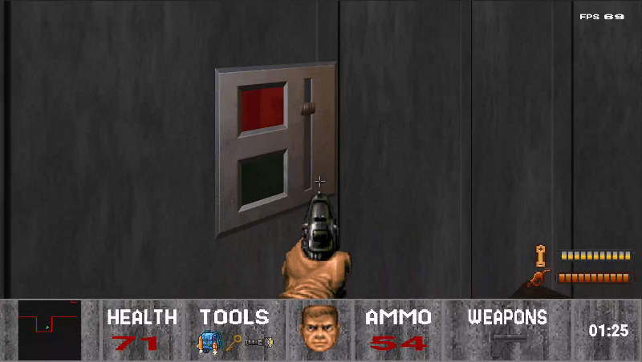**

- **Secteurs de forme libre** : les pièces peuvent avoir autant de murs que tu veux, dans toutes les directions (rendu par portails, jusqu'à 128 niveaux de profondeur)
- **Hauteurs de sol et de plafond variables** d'un secteur à l'autre, avec rendu des marches (murs hauts / bas)
- **Sols et plafonds inclinés** : les secteurs ont de vrais plans en pente
- **Textures** sur les murs, les sols et les plafonds (texture haute, milieu et basse par mur)
- **Ciel** à la place du plafond sur les secteurs extérieurs
- **Murs semi-transparents** (alpha de 0 à 255) qui laissent voir la pièce derrière
- **Décals** posés sur les murs par-dessus la texture : fenêtres, interrupteurs, interrupteurs à clé…
- **Éclairage par secteur** : chaque zone a son niveau de lumière, qui affecte murs, sols et sprites
- **Lampe torche** : cercle de lumière dynamique au centre de l'écran, qui consomme de la batterie
- **Sprites billboard** (toujours face au joueur) pour les objets et les props
- **Sprites directionnels sur 8 angles** pour les PNJ et les autres joueurs : on les voit de face, de profil ou de dos selon où on se trouve
- **Z-buffer** : les sprites sont correctement masqués par les murs
- **Rendu multithreadé** : l'écran est découpé en 8 bandes calculées en parallèle avec `pthread`

**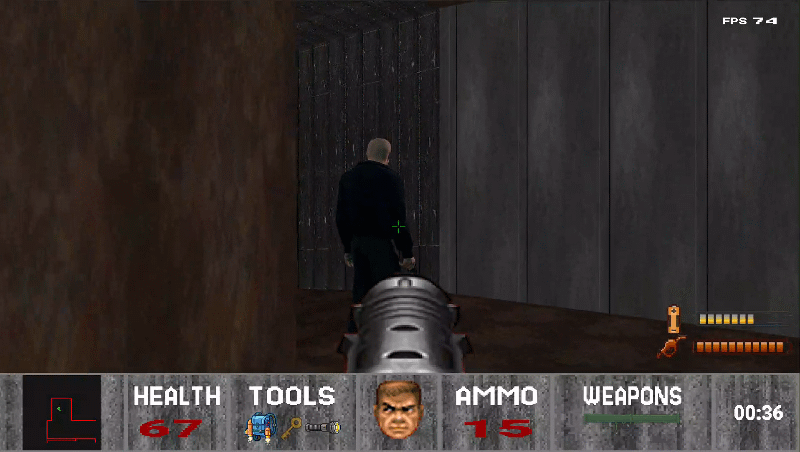**

---

## 🏃 Gameplay

### Déplacements et physique

- Déplacements fluides indépendants du framerate (delta time)
- **Strafe**, **course**, **accroupi** (et relevé)
- **Saut** et **chute** avec gravité
- **Jetpack** pour voler, alimenté en carburant
- **Collisions** avec les murs (glissement le long des parois) et gestion des **marches** de hauteur raisonnable
- Les props comme les barils **bloquent le passage** selon leur taille (hitbox)

### Interactions

- **Interrupteurs** sur les murs (`E`) qui déclenchent des **ascenseurs** et des **portes**
- **Interrupteurs à clé** : il faut avoir ramassé une **clé** pour les activer
- **Ascenseurs** : le sol et le plafond d'un secteur se déplacent en temps réel, ce qui modifie la géométrie du niveau en jeu
- **Ascenseur de sortie** : fin du niveau et chargement du suivant
- **Dialogues avec les PNJ** (`E` en les visant) : ils donnent les indices pour avancer
- **Notifications** affichées à l'écran par-dessus le jeu
- **Flash visuel** quand on ramasse un objet + son de ramassage

### Combat

- Visée au **crosshair** sur les ennemis
- **Projectiles** : les roquettes volent dans le monde, **explosent** au contact des murs et des entités, avec animation d'explosion
- Les ennemis **tirent sur le joueur** quand il est dans leur champ de vision
- **Game over** quand les PV tombent à 0, avec écran dédié

**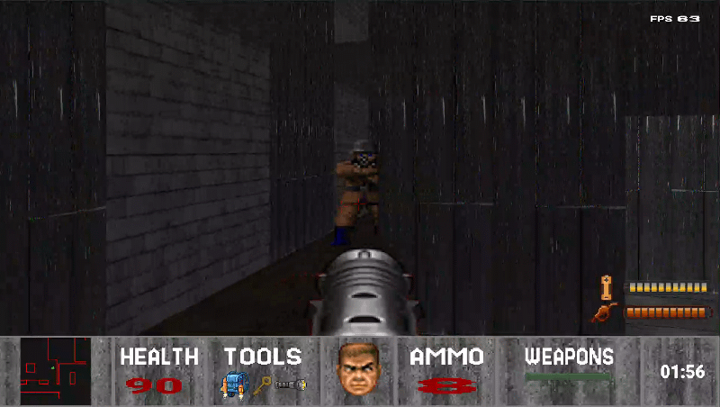**

**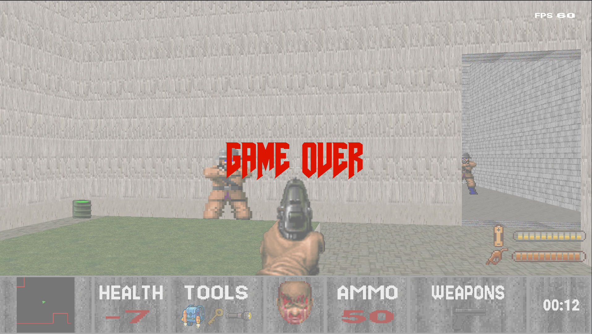**

### Son

- **Musique** dans les menus et en jeu
- **Bruitages** : tirs, lance-roquettes, ramassage d'objets

---

## 🔫 Armes, objets et inventaire

Les objets se ramassent en marchant dessus et remplissent l'**inventaire** (jusqu'à 4 armes et 3 outils).

### Armes

| Arme | Dégâts | Particularité |
|---|:---:|---|
| 👊 **Poings** | 25 | Toujours dispo, munitions infinies, courte portée |
| 🔫 **Pistolet** | 50 | Arme de base |
| 💥 **Fusil à pompe** | 100 | Gros dégâts |
| 🚀 **Lance-roquettes** | 200 | Tire un projectile qui explose |

Chaque arme a son **sprite animé en vue FPS** (tir, recul) et son icône dans le HUD.

| | |
|:---:|:---:|
| 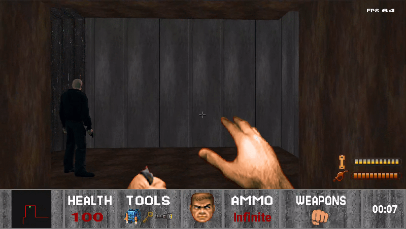 | 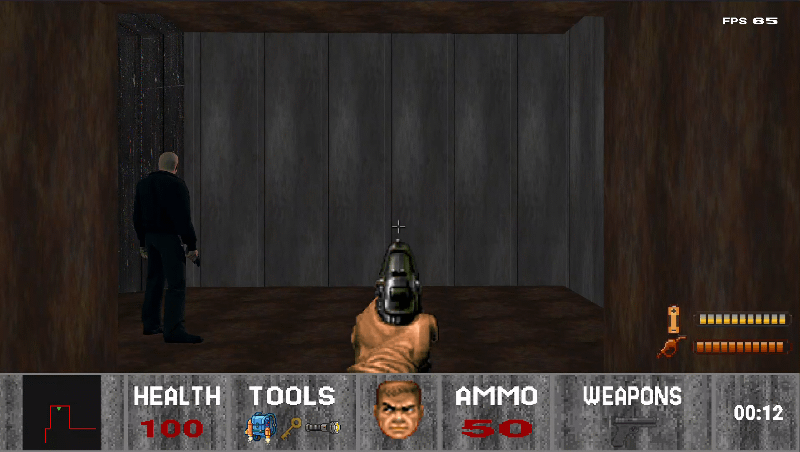 |
| 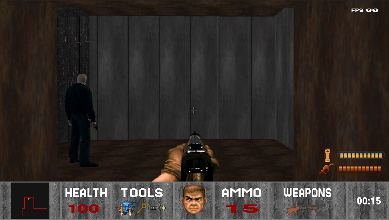 | 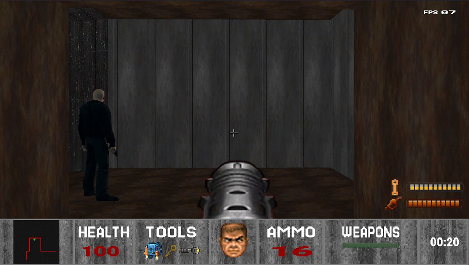 |

### Outils

| Outil | Rôle |
|---|---|
| 🔦 **Lampe torche** | Éclaire les zones sombres, consomme de la batterie |
| 🔑 **Clé** | Débloque les interrupteurs verrouillés |
| 🎒 **Jetpack** | Permet de voler, consomme du carburant |

### Consommables

| Objet | Effet |
|---|---|
| ❤️ **Medkit** | Rend des PV |
| ⛽ **Carburant** | Recharge le jetpack |
| 🔋 **Batterie** | Recharge la lampe torche |

---

## 👾 Ennemis, boss et PNJ

Les ennemis ont une **IA** : champ de vision (distance + angle), vérification qu'aucun mur ne bloque la vue, poursuite du joueur en glissant le long des murs, attaque à portée avec cadence de tir et dégâts aléatoires (et parfois ils ratent). Chaque ennemi a ses animations **idle / tir / mort**.

### Ennemis

| | PV | Vitesse | Dégâts |
|---|:---:|:---:|:---:|
| **Ennemi 1** | 100 | Rapide | 15 |
| **Ennemi 2** | 130 | Lent | 5 (cadence élevée) |
| **Ennemi 3** | 250 | Moyen | 10 |

### Boss

| | PV | Dégâts |
|---|:---:|:---:|
| **Boss 1** | 500 | 20 |
| **Boss 2** | 500 | 20 |
| **Boss 3** (boss final) | 350 | 25 |

| | | | |
|:---:|:---:|:---:|:---:|
| 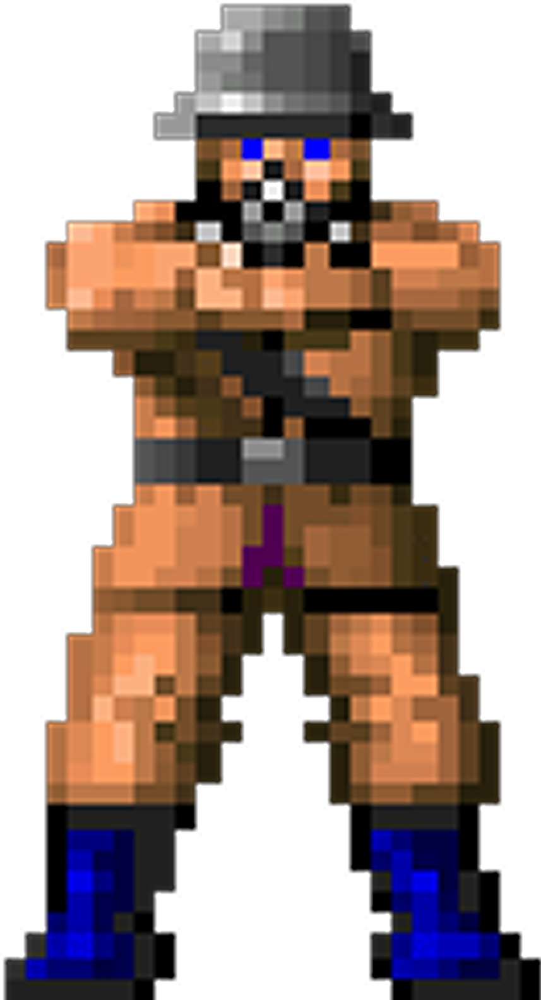 | 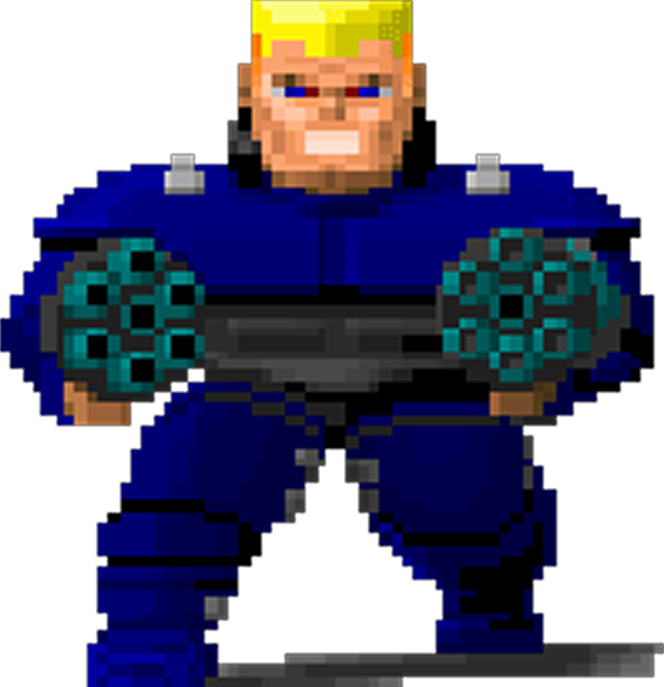 | 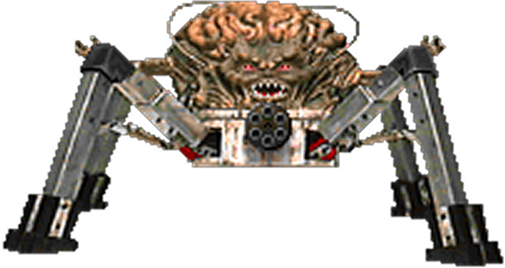 | 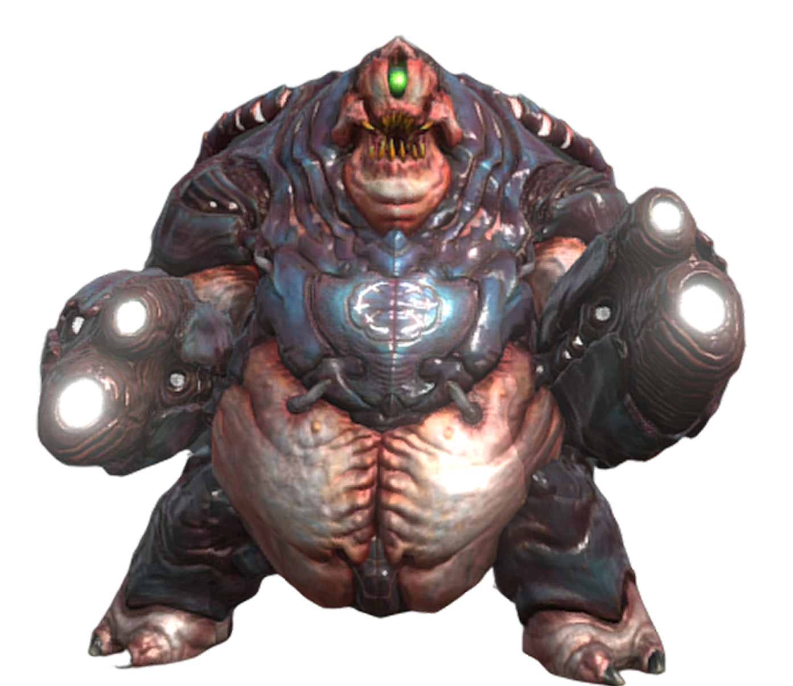 |

### PNJ

Des personnages alliés, en sprites 8 directions, qui guident le joueur à travers l'histoire :

- **Tung Sahur** : *« The office upstairs opens the labs. The key is in containment! »*
- **Captain** : *« The control room opens the cave gate. It came through down there. »*
- **Mr White** : *« It's behind that door. Raid the armory first... and end this. »*

| | | | |
|:---:|:---:|:---:|:---:|
| 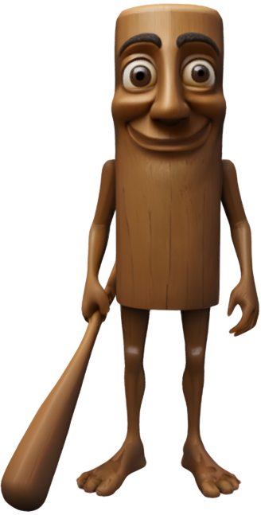 | 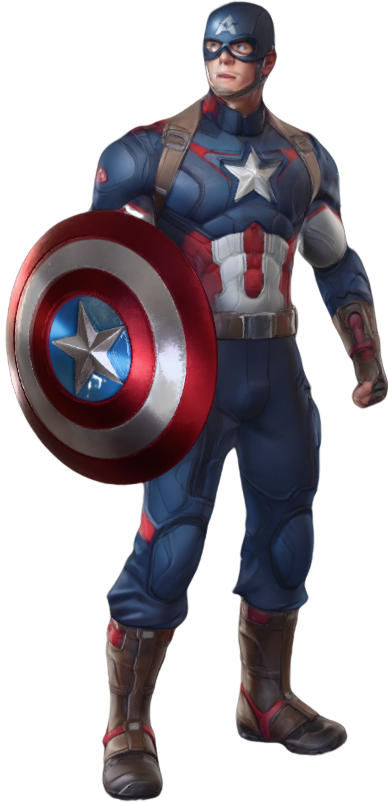 | 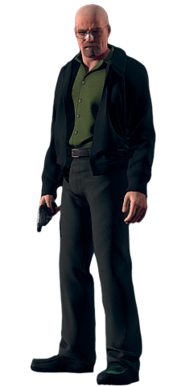 |

---

## 📊 HUD

Le HUD est composé de plusieurs modules répartis sur l'écran (pas un simple bandeau) :

- **Portrait du joueur animé** qui change selon son état : normal, blessé, en sang, mort
- **Barre de vie**
- **Munitions** de l'arme courante
- **Armes** possédées
- **Outils** possédés (grisés tant qu'on ne les a pas)
- **Jauges** de batterie (lampe) et de carburant (jetpack)
- **Minimap** en temps réel avec les murs et la position du joueur
- **Timer** de partie
- **Crosshair**
- **Compteur de FPS**

**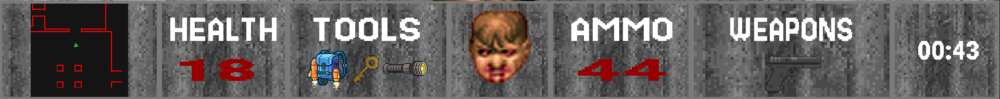**

---

## 🗂️ Menus et interface

- **Menu principal** avec logo et musique : Jouer, Paramètres, Éditeur de niveaux
- **Lobby solo** : choix du niveau (1, 2 ou 3)
- **Lobby multijoueur** : héberger ou rejoindre une partie
- **Menu pause**
- **Écrans Game Over et Victoire**
- **Écran de chargement**
- Interface **responsive** : s'adapte à toutes les résolutions

### Paramètres

- **Remapping des touches** de déplacement
- **FOV** et **sensibilité de la souris** (sliders)
- **Résolution**
- **Mode d'affichage** : plein écran, fenêtré sans bordure, fenêtré
- **Langue** : 🇬🇧 anglais, 🇫🇷 français, 🇷🇸 serbe, 🇲🇦 arabe. Toute l'interface et les sous-titres des cinématiques sont traduits.

**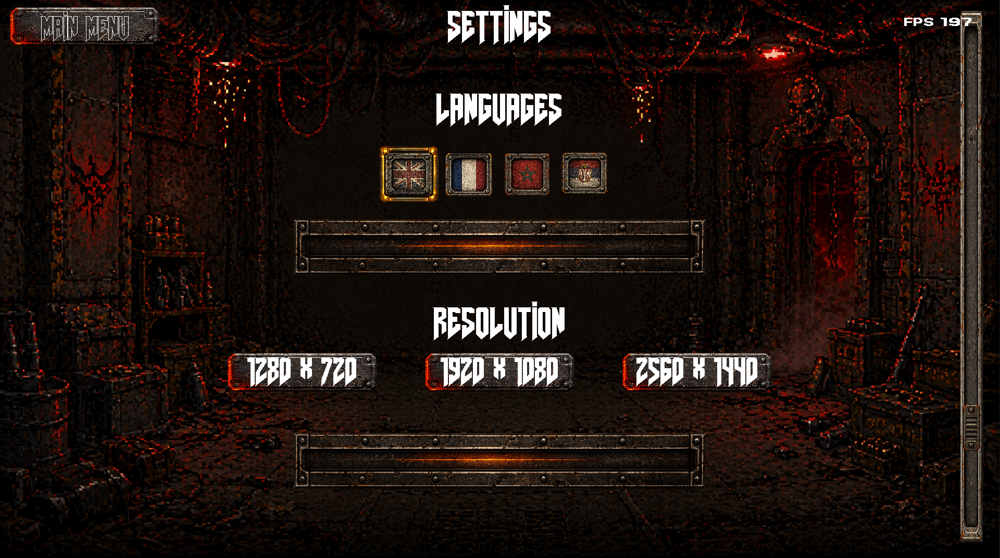**

---

## 🎨 Musique custom

**Musique faite par Theophane Duranceau**

🎵 [Écouter la musique du menu](assets/sounds/Menu.mp3)\
🎵 [Écouter la musique des niveaux](assets/sounds/Level.mp3)

---

## 🌐 Multijoueur

- **Jusqu'à 4 joueurs** en réseau local (UDP, port `2026`)
- Un joueur **héberge**, les autres **rejoignent** en tapant l'IP de l'hôte
- **Lobby** avec les avatars animés des joueurs connectés
- Synchronisation des positions, angles et PV des joueurs
- Les autres joueurs sont affichés avec des **sprites directionnels** (de face, de profil, de dos, animation de marche)
- **Entités synchronisées** : l'hôte fait autorité sur les ennemis et applique les dégâts envoyés par les clients
- Gestion des **déconnexions** (timeout) et délai de grâce pendant le chargement de la map

---

## 🛠️ Éditeur de niveaux

L'éditeur est **intégré au binaire** et accessible depuis le menu principal. Il permet de construire un niveau entier puis de le sauvegarder dans `saves/`.

**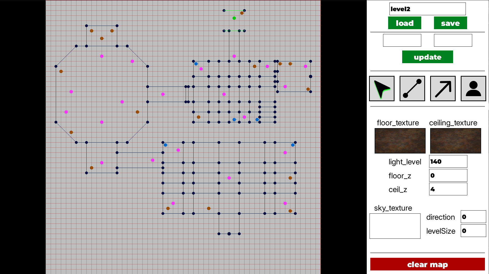**

### Outils

| Outil | Rôle |
|---|---|
| 🖱️ **Sélection** | Sélectionner un secteur ou un mur pour éditer ses propriétés |
| 🧱 **Mur** | Tracer des murs point par point. Les **secteurs sont détectés automatiquement** dès qu'une forme est fermée |
| 📐 **Pente** | Tracer une flèche pour incliner le sol ou le plafond d'un secteur |
| 👾 **Entité** | Placer le spawn du joueur, des ennemis/PNJ, des objets, des props et des décals sur les murs |

### Propriétés éditables

- **Murs** : textures haute / milieu / basse, transparence
- **Secteurs** : hauteur du sol et du plafond, texture du sol, du plafond ou du **ciel**, niveau de **lumière**, paramètres d'**ascenseur** (direction, amplitude)
- **Décals** : interrupteurs liés à un ascenseur, avec ou sans clé

### Fonctionnalités

- Grille avec **zoom** et déplacement
- **Sélecteur de textures** visuel
- Suppression de points, de murs, de pentes et d'entités
- **Sauvegarde / chargement** de maps par nom
- Format de map **binaire et autosuffisant** : géométrie, textures (pixels compris), décals, ascenseurs et entités dans un seul fichier

---

## ⚙️ Sous le capot

- **C**, sans variables globales, avec la **libft**
- **SDL2** uniquement pour la fenêtre, les events, l'affichage du framebuffer, le texte (SDL2_ttf) et le son (SDL2_mixer)
- **Décodeur PNG fait maison** : parsing des chunks, décompression **zlib / DEFLATE** (Huffman, LZ77) et filtres PNG, sans aucune lib d'image
- Chargement des images **en parallèle** avec des threads
- Rendu raycasting **multithreadé** (8 threads)
- Serveur multijoueur dans son propre **thread**

```
srcs/
├── raycasting/    moteur de rendu (portails, pentes, transparence, décals, ascenseurs)
├── GUI/           menus, HUD, cinématiques, minimap, notifications
├── player/        physique (saut, course, accroupi, jetpack) et tir
├── entities/      ennemis, boss, PNJ, props, IA, projectiles
├── items/         objets au sol, ramassage, inventaire
├── editor/        éditeur de niveaux et sauvegarde des maps
├── multiplayer/   serveur et client UDP
├── parser/png/    décodeur PNG maison
├── languages/     système de traduction
└── sounds/        musique et effets sonores
```

---

## 👥 Équipe

| | Login |
|---|---|
| 👤 | **aabouyaz** @AnasLVP|
| 👤 | **edurance** @nightfly60|
| 👤 | **lle-duc** @ThatsLucas|

---

<div align="center">

*Projet réalisé à 42 · Licence MIT*

</div>
